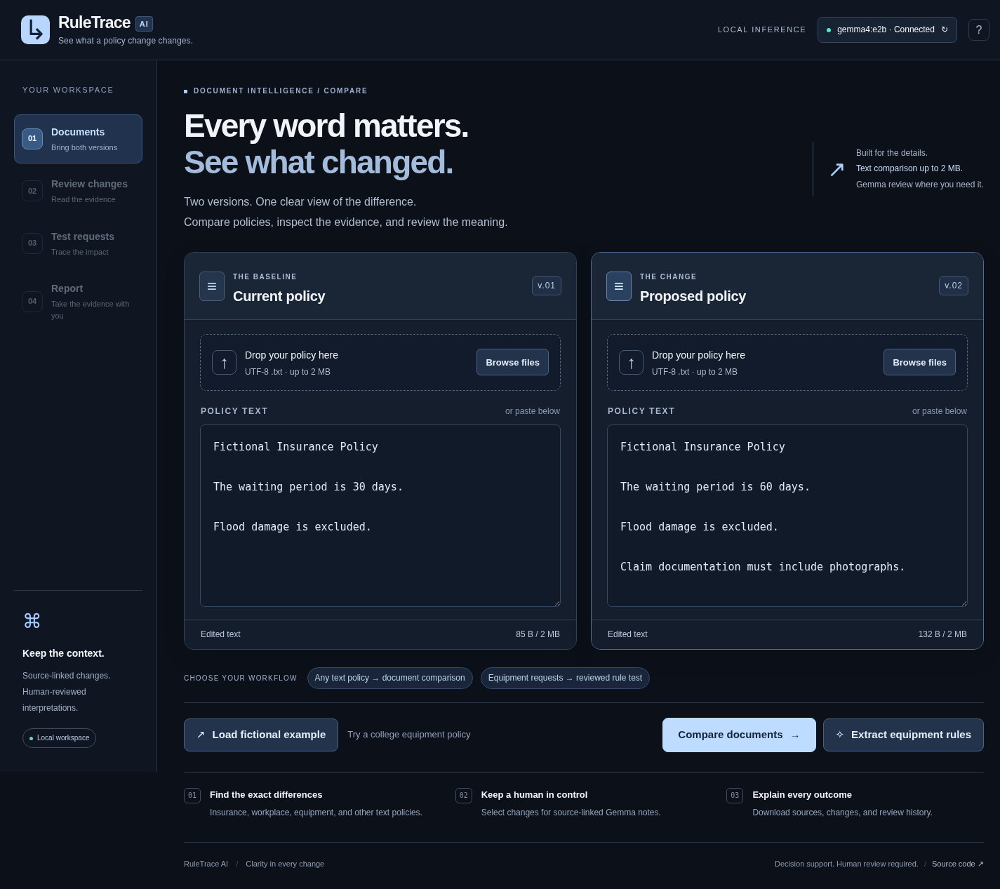
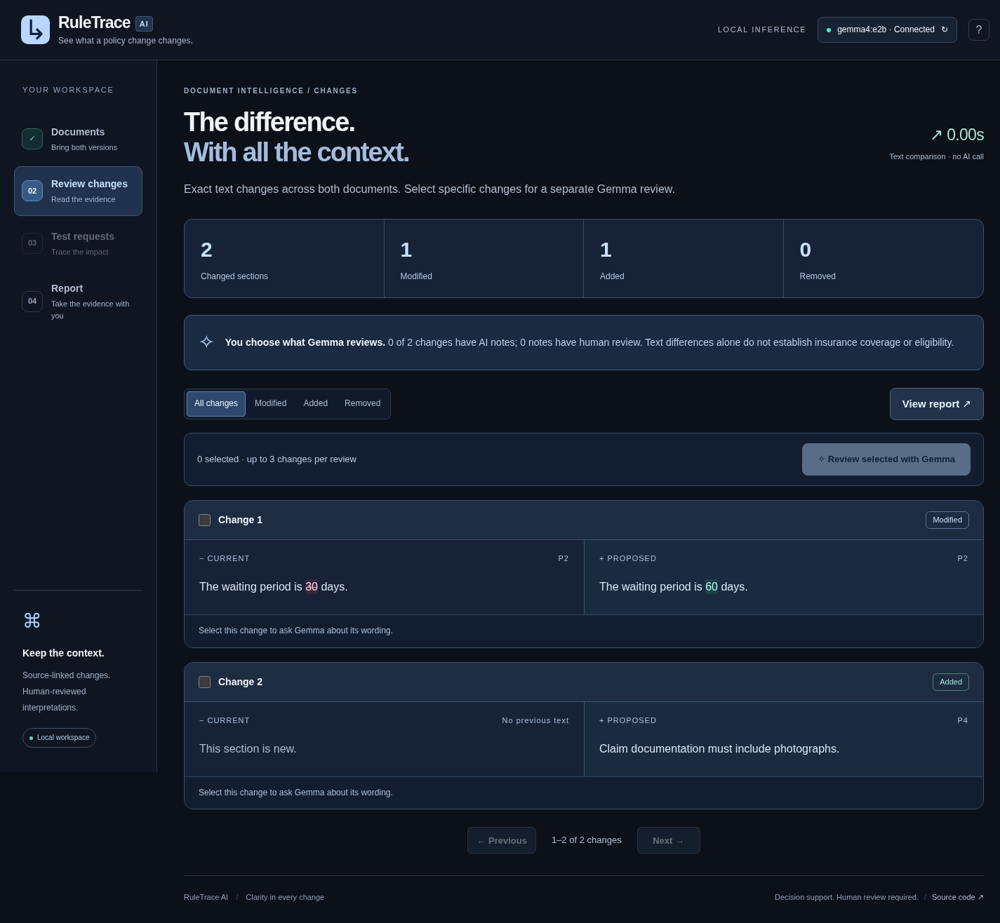

# RuleTrace AI

**See what a policy change changes.**

RuleTrace compares two policy versions, highlights exact text changes, and uses local **Gemma 4 E2B** to interpret the changes you select. Every AI reading stays linked to source text and can be approved, corrected or rejected. A separate equipment workflow evaluates requests using reviewed rules and deterministic Python.



A solo project by Tharun, with significant OpenAI Codex assistance. This is a decision-support prototype. Source citations and AI interpretations do not establish insurance coverage, legal meaning, or eligibility.

## Two workflows, explicit scope

| Workflow | Supported input | What it does |
| --- | --- | --- |
| **Compare documents** | Text-based PDFs up to **2 MB each**, or pasted text | Compares the complete text, pages through added/removed/modified source sections, highlights changed words, and exports all changes. Works with insurance, workplace, equipment and other policy text. |
| **Review selected with Gemma** | Up to three changes from a document comparison | Runs real local inference on those changes only. Proposes short explanations with exact source passages. Human review and corrections are recorded. Unselected changes remain unreviewed. |
| **Extract equipment rules** | Short equipment borrowing policies, up to 6,500 bytes and 40 paragraphs each | Gemma proposes supported item, duration and training rules. After explicit human review, Python compares editable borrowing requests under both policies. |

Large upload support does **not** mean the entire document fits in the model's 4K context, or that every policy domain has an eligibility evaluator. Text comparison is deterministic and does not call a model. Selected Gemma notes never enter the equipment rule engine.

**Uploads:** text-based `.pdf` files up to 2 MB and 200 pages each. The server extracts the text into the editable preview. Scanned/image-only and password-protected PDFs are rejected; OCR is not included. You can still paste policy text directly. **Reports:** readable PDF is the primary download, with JSON audit data available separately.



## Performance: what is actually fast?

File size and model generation latency are different constraints. Tiny inputs can still take tens of seconds on CPU because the model must evaluate a prompt and generate structured output.

- In the measured browser run, two **1,715,000-byte documents**, including one added section, were compared in **0.042 seconds of server comparison time**. Upload and rendering time are additional. This is text comparison, not AI inference.
- The compact equipment extraction previously took **53.419 seconds** for the example pair, down from **88.58 seconds** before output optimization.
- The verified selected waiting-period change took **27.537 seconds** of real local Gemma inference. A 15-second fresh-inference guarantee has **not** been established.
- Repeated equipment extraction for identical texts can reuse a previously validated live response. It is explicitly labelled **Reused verified Gemma extraction**, preserves the original generation time and latency, makes zero new model calls, and starts a fresh human review. **Run fresh Gemma extraction** bypasses reuse.

No canned examples or mock responses are used in the application. Reuse is in-memory, limited to eight entries, tied to exact texts, verified model digest and prompt version, and cleared on restart. Reports distinguish `live-local-ollama` from `cached-local-ollama`.

See [document verification metadata](docs/document-verification.json), [equipment model checks](docs/model-verification.json) and [verification notes](docs/VERIFICATION.md). Observed timings are not guarantees or general accuracy estimates.

## Run on another computer

Use Python **3.11+** (verified on 3.13.12), current Ollama supporting Gemma 4 and structured outputs, and sufficient RAM for E2B. The prepared laptop has approximately 16 GB RAM and uses CPU inference.

```bash
git clone https://github.com/sukuna-exe/Hackfest.git
cd Hackfest
python3 -m venv .venv
source .venv/bin/activate
python -m pip install -r requirements.txt
```

Install Ollama using the [official Linux instructions](https://docs.ollama.com/linux). Check for a server before launching another one:

```bash
curl --max-time 5 http://127.0.0.1:11439/api/tags
# If no server is listening, run in its own terminal:
OLLAMA_HOST=127.0.0.1:11439 OLLAMA_CONTEXT_LENGTH=4096 ollama serve
```

In the application terminal:

```bash
OLLAMA_HOST=127.0.0.1:11439 ollama pull gemma4:e2b
python -m uvicorn app.main:app --host 127.0.0.1 --port 8000
```

Open **http://127.0.0.1:8000**. Text comparison works without Ollama; AI features require it. The app serves its own HTML, CSS and JavaScript. Use one worker and keep it bound to loopback; reviews and document sessions are held in memory.

For an existing Ollama server on a different port:

```bash
export RULETRACE_OLLAMA_URL=http://127.0.0.1:11434
```

Settings are listed in [.env.example](.env.example). Export them in the shell; `.env` is not loaded automatically. Default model: `gemma4:e2b`; model request timeout: 150 seconds; equipment analysis deadline: 310 seconds. No hosted endpoint or replay mode is configured.

## Prepared local environment

The original isolated Python and model preparation remain outside this repository. Start Ollama only if the endpoint is unavailable:

```bash
export OLLAMA_HOST=127.0.0.1:11439
export OLLAMA_MODELS=/home/tharun/hackfest-prep/models
export OLLAMA_CONTEXT_LENGTH=4096
/home/tharun/hackfest-prep/tools/ollama/bin/ollama serve
```

Run the app from a separate terminal:

```bash
cd /home/tharun/Hackfest
/home/tharun/hackfest-prep/.venv/bin/python -m uvicorn app.main:app --host 127.0.0.1 --port 8000
```

Model weights, virtual environments and caches are not committed. A compatible offline wheel cache and lockfile are available in the preparation directory; other developers should use the normal setup above.

## Compare real policy documents

1. Upload current and proposed **PDFs**, up to 2 MB and 200 pages each, or paste policy text. Check each extracted preview against its PDF before comparing; reading order and table layout can differ.
2. Click **Compare documents**. Inspect the complete text comparison using filters and pagination.
3. Select up to three changes and click **Review selected with Gemma**. Only those source passages are sent to the local model. Each selected change is required in the structured response; incomplete output triggers one bounded repair and a specific validation error rather than being shown as a complete analysis.
4. Check each proposed reading. **Approve reading** confirms the interpretation matches its sources; **Edit** records a correction; **Reject reading** marks it incorrect. These actions do not approve a policy change or determine coverage.
5. Open **Report** and click **Download PDF report**. It includes a clear summary, every changed source passage, AI interpretations and corrections, review status, and provenance. **Export audit data (JSON)** is a secondary option containing both complete original texts and the full machine-readable audit history.

The interface never labels unselected changes as AI-reviewed. A report can contain pending notes; their status remains explicit. Changing either policy invalidates the comparison and its notes. A browser refresh starts a new workspace; a server restart loses in-memory sessions.

## Equipment demonstration

Upload [old_policy.pdf](examples/old_policy.pdf) as Current and [new_policy.pdf](examples/new_policy.pdf) as Proposed, or click **Load fictional example** to paste the canonical sample text. Then click **Extract equipment rules**. The [current policy](examples/old_policy.txt) permits three items for seven days without a training prerequisite. The [proposed policy](examples/new_policy.txt) permits two items for five days and requires completed training.

Review six rule proposals and confirm both document headings. Then open **Test requests** and evaluate the [five fictional requests](examples/test_cases.json):

| Case | Current | Proposed | Reason |
| --- | --- | --- | --- |
| Asha | Allowed | Disallowed | Three items exceed the new two-item limit. |
| Ravi | Allowed | Disallowed | Training is now required. |
| Meera | Allowed | Allowed | Meets both reviewed policies. |
| Kiran | Allowed | Disallowed | Six days exceed the new five-day limit. |
| Dev | Allowed | Needs review | Training status is unknown. |

The application uses the full labels **Allowed under reviewed rules**, **Disallowed under reviewed rules**, and **Needs review**. Results are computed from reviewed rules, not hardcoded. Example loading supplies policy text and requests only.

Add `Project teams may receive special consideration.` to test ambiguity. It must remain unresolved. Acknowledgment records human review without turning uncertainty into permission.

### Deterministic semantics

The evaluator supports only `items_requested`, `days_requested`, and `training_completed`. Numeric rules use `lte` with integers 1–365. Training uses `eq` with a strict boolean. **`training_completed eq false` explicitly means no training prerequisite**, never that the borrower must be untrained. Omitted requirements remain unresolved.

For ready policies, a known failed condition takes precedence over missing inputs. If none fail but a required fact is unknown (`null`), return Needs review. Otherwise return Allowed under reviewed rules.

Pending, rejected, conflicting, missing or unresolved interpretations prevent definitive outcomes for that policy. All supported concepts require one approved rule. Every paragraph is accounted for, and source references are validated. Exact text does not prove the interpretation is correct.

Evaluation accepts server analysis IDs, revisions, original text hashes and cases—not client-supplied approved rules. Edits increment the revision and remove previous results. Document AI notes cannot be passed to the evaluator as approvals.

## Architecture

```text
PDF upload (up to 2 MB / 200 pages) → isolated text extraction → editable preview
    or direct policy text paste (up to 2 MB)
    → bounded source sections → deterministic text comparison → paged source-linked changes
    → selected changes → local Gemma notes → human review → complete comparison report

Short equipment policies
    → numbered paragraphs → restricted Gemma JSON → strict validation + exact evidence
    → server-held human review → deterministic Python evaluator → outcome report
```

| Module | Responsibility |
| --- | --- |
| `app/uploads.py`, `app/pdf_import_worker.py` | Bounded PDF upload, isolated extraction, page/text limits and editable previews. |
| `app/documents.py` | Large text segmentation, diff, pagination, selected notes, human review and comparison reports. |
| `app/inference.py` | Verified Ollama identity, bounded model calls, schema repair and labelled exact-input extraction reuse. |
| `app/extraction.py` | Equipment evidence validation, hashes, restricted rule expansion and readiness. |
| `app/evaluator.py` | Pure Python evaluation; never calls a model. |
| `app/schemas.py`, `app/limits.py` | Typed inputs, validated values and upload/request bounds. |
| `app/pdf_reports.py` | Print-friendly PDF summaries, outcomes, source passages and review status; no inference. |
| `app/main.py` | FastAPI routes, revisions, static hosting and security boundaries. |
| `app/static/` | Responsive HTML5, CSS3 and vanilla JavaScript; no CDN or build step. |

Technology: Python, FastAPI, Pydantic, HTTPX, Uvicorn, Ollama, Gemma 4 E2B, ReportLab PDF generation, HTML/CSS/JavaScript and pytest. PDF text extraction uses pypdf; uploads use python-multipart. No database, authentication, agent framework, arbitrary model expressions, frontend framework or OCR.

See [API contract](docs/API.md), `/docs`, and `/openapi.json`.

## Tests

```bash
python -m pip install -r requirements-dev.txt
python -m pytest -q
```

Isolated tests use labelled synthetic extraction fixtures and mocks for failure paths. They cover rule boundaries, training semantics, unknown facts, schema and source validation, review integrity, stale results, model failures, 2 MB uploads, Unicode, complete text comparisons, pagination, scoped review and labelled reuse. They do not establish model accuracy.

Real model integration, separate from mocked tests:

```bash
python -m scripts.verify_model
```

This checks the actual example pair and [held-out wording](examples/held_out_policy.txt) against independently specified values, preserves ambiguity, and evaluates the five expectations. Approval is automated only inside that test harness; the application requires explicit human actions.

Optional browser tooling needs installed Chromium, the development requirements above (including the PDF verification library), and `websockets`:

```bash
python -m pip install websockets==17.3
chromium --headless --remote-debugging-port=9223 --user-data-dir=/tmp/ruletrace-browser about:blank
python -m scripts.browser_check
python -m scripts.check_documents
python -m scripts.check_pdf_reports
python -m scripts.check_pdf_uploads
```

Use a disposable profile. Restricted containers may need their own sandbox launch configuration. The checks exercise real model inference, review, correction, reports, actual megabyte-size file uploads, literal HTML handling and responsive layouts. Screenshots use fictional text and automated QA review, not institutional approval.

## Limits

- PDF uploads accept selectable-text PDFs up to **2,097,152 bytes and 200 pages**. The extracted text and direct paste are also limited to 2 MB. HTTP bodies are capped at 16 MB. Password-protected, damaged and unreadable/scanned pages are rejected; OCR is not supported. Review extracted text against the original, especially columns, tables and OCR text layers.
- PDF parsing runs in a separate process with a 40-second wall-clock deadline and at most two concurrent imports. Linux workers also have 512 MB address-space and CPU limits. Page content streams are bounded to 8 MB. Uploaded binaries are not retained; page offsets and extracted text are returned.
- Source sections for document comparison are bounded to 900 UTF-8 bytes, up to 12,000 sections. Long paragraphs are split at safe boundaries. Blank-line formatting and whitespace around sections are ignored; original texts remain intact in the report. Alignment shows text differences, not semantic equivalence. Very repetitive text or paragraph restructuring can produce noisy comparisons.
- Document changes are paged 20 at a time. Reports include every change and both full texts. At most three changes and a bounded 7,000-byte serialized source payload are sent to Gemma per notes request.
- Only selected changes have AI notes. Notes are prose decision support, not executable rules or coverage decisions. Unsupported interpretations and human rejections remain visible.
- Equipment extraction remains limited to 6,500 bytes and 40 paragraphs per version. Its supported fields do not cover insurance eligibility, medical claims or general legal rules.
- One local inference at a time; finite timeouts and at most one output repair. Fresh inference below 15 seconds is not guaranteed on this CPU. Reuse is explicitly labelled.
- Local single-user scope: unauthenticated reviewer identity, two-hour in-memory sessions, 24 document comparisons, 64 equipment analyses, eight cached extraction pairs and 100 equipment requests. Model notes and reports may contain private text; choose appropriate data before sharing them.
- Refreshing clears browser state; restarting clears server sessions and inference reuse. Moving between stages preserves current inputs; failed requests preserve entered text.

## Readable PDF reports

PDF is the primary report download for both workflows. It is generated locally from the current server-validated snapshot, without another model call. Reports use A4 pages, embedded fonts, readable summaries, source evidence, review labels, page numbers and provenance. Tables wrap and repeat headers across pages; all document changes are included, not just the visible page. Original AI readings remain distinct from reviewer corrections. Unrequested AI review and incomplete human review are stated explicitly.

PDFs contain the compared source passages and report details. Use the optional JSON audit export for the complete original documents and machine-readable review history. Long comparisons can produce long PDFs. Embedded DejaVu Sans supports many scripts; characters and complex-script shaping outside its coverage may require additional font support.

## License and attribution

The repository's original [MIT application license](LICENSE) and copyright are preserved. Third-party libraries retain their own licenses. The bundled, unmodified DejaVu fonts have their own [Bitstream Vera font license and notices](app/fonts/LICENSE.txt), separate from the application MIT license. ReportLab and the PDF verification library also retain their own licenses. No model weights are distributed.

Gemma is developed by Google DeepMind. Its model license is separate from the application's MIT license. The official [Gemma terms page](https://ai.google.dev/gemma/terms) directs Gemma 4 users to its [Apache 2.0 license](https://ai.google.dev/gemma/apache_2). Check notices for the exact artifact you obtain or redistribute. See [Gemma 4 on Ollama](https://ollama.com/library/gemma4) and [structured-output documentation](https://docs.ollama.com/capabilities/structured-outputs).

## AI assistance disclosure

Tharun is the sole human developer. **OpenAI Codex** significantly assisted implementation, debugging, frontend design, testing, verification and documentation. This project was not coded entirely by hand. The application uses local Gemma 4 for interpretation; Codex is the development assistant. No other team members or contributions are invented.

[Demo script](docs/DEMO.md) · [Verification record](docs/VERIFICATION.md) · [Submission draft](docs/SUBMISSION.md)

No push, deployment or submission is performed without the developer's explicit authorization.
